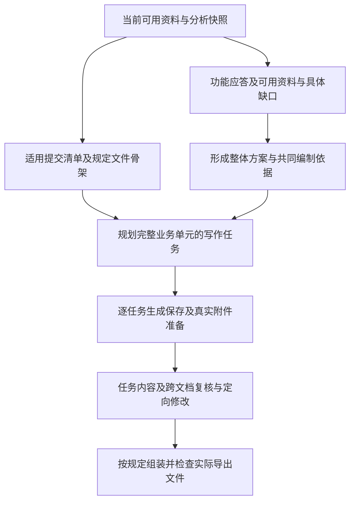

# Python投标编制架构草案

本稿定义利用分析资料编制文件的职责，不新增通用skill运行时。分析五节点与
analysis-ready保持原义；编制目标为保留完整结构、用匹配资料编写应答，无依据留空，
不以确认或资料齐备为整份生成的前置。
输入、恢复及发布统一以固定可用快照为边界；具体源码、部署与实测进度见[交接](handoff.md)。
数据语义统一在[字段字典](field-dictionary.md#python编制执行合同t3至t5)，
任务沿用[实施规划](implementation.md#python投标编制闭环任务规划独立于一期)。

本稿以下编制修订以[knowledge_required_v2合同](field-dictionary.md#编制最小修订knowledge_required_v2)
为准；实施与真实验证状态见交接，设计文档不代替验收。不增加Agent、节点或复杂状态。
提交结构、格式角色、表单实例及总稿/分卷归属的具体修复见
[完整方案](submission-structure-plan.md)；字段合同见字典BUG-054节；实际实施与验证状态见交接。

## 完整投标文件的交付目标

编制的目标是形成一套符合本项目要求、回答具体、证据适用、各部分一致且可以按规定
交付的文件。完成多少章节或生成多少页只是进度信息，不能证明投标完整或获得评分。

| 核对对象 | 完成依据 |
| --- | --- |
| 投标主体与响应条件 | 主体、标段、资格、项目授权及实质性条件有对应事实；区分已有依据、待证明和明确不符，重大缺口由业务人员补资料、调整方案或决定是否继续 |
| 本次交付组成 | 根据须知、评审办法、技术规范、格式和补遗确定实际文件/分册，区别本次必交、条件适用及履约阶段材料，不能照抄全部招标目录 |
| 商务及资格材料 | 函件、声明、证明、商务响应及适用保证手续按原规定填写，主体、签署身份、日期和材料有效性一致 |
| 技术响应及评分依据 | 具体方案、逐条响应、偏离、表格及证明对应实际要求；评分主张有具体内容和适用证据，便于评审查阅，不承诺实际得分 |
| 商务技术报价一致 | 供货范围、配置、工期、验收、服务及适用商业条款共同表达同一方案；保留报价表、招标预算/限价及价格评分要求，投标人最终价格留给人工填写 |
| 实际文件与提交要求 | 固定文字、表格、附件、分册和可读性经过实物检查；签章、加密、上传及回执只在真实操作完成后记为完成 |

以上是内容质量核对，不是生成或导出条件。任何资格、评分、产品、人员、价格、证明、
模板或确认问题均不因业务门禁使编制失败：能写的写，未知的留空或待补，仍保存和导出。
“文件已生成”与“内容是否齐备、是否已签章提交”分别报告，不靠虚构填值消除缺口，
也不增加“先补齐/确认才能下载”的步骤。

复用规则、响应位置、采用证据及产物引用，派生“要求/评分点→本项目具体响应→证明→
实际文件位置→剩余事项”的交付核对视图。模型判断回答及证明是否充分，宿主维护关联
和最终定位；不另建招标事实台账，不要求模型誊写全量清单或猜测最终页码。

## 缺资料时的默认处理

| 情况 | 默认处理 |
| --- | --- |
| 名称、型号、人员、参数或其他必填信息未知 | 保留原字段或表格位置，留空；在不破坏规定格式时可写“待补充”，原文要求必填也不阻止生成 |
| 投标报价、单价、总价、折扣等最终值 | 保留原表和字段，最终值留空交人工补充；不从历史/参考资料填值、不填0或自动算价，招标预算、限价及原文数量照常保留 |
| 没有匹配知识文档 | 企业应答留空，不自由设计技术/实施/服务方法；允许tender支持的位置仍可编写原文可确定的背景/说明和填值，保留固定模板与缺口，不反复检索到命中 |
| 缺证书、报告、授权或签章 | 保留附件/签署位置并记录待提供，继续组装；不制造原件、不把空附件记为已提供 |
| 规定格式来源暂缺或不可读 | 用当前已知结构保留该位置及待补说明，其他内容照常导出，不声称已保留未知原格式 |
| 未确认分析、部分分析结果或业务复核存在问题 | 固定当前可读资料和真实状态，继续生成；不确定解释或相互冲突的具体值保留待核对，不默认选一方作为事实 |
| 局部写作/复核调用恢复后仍失败 | 写作失败保留空位；初审仅接口/预算失败保留未被否定的U0待核，已有明确否定时修订失败或再核不可用回退剔除问题后的S0；保留原稿/回执继续导出 |

待补信息定位到实际文件、章节、表格或附件，便于用户后续填写；原格式不能放说明时，
保留空白并在文件外的缺口清单展示。未被要求的可选信息缺省不制造待补项。复核可提出
修订，但不会成为文档可读、可下载的开关，不能因评分不够或证据不足反复生成到预算耗尽。

编制只需固定可用输入快照，包括实际引用、来源版本、已有分析状态与缺失情况。核验
产物及依赖可读时使用既有接受决议形成的有效投影；否则保留已有抽取及未核验含义，
只有来源时使用原文，不伪造确认、补遗决议或有效规则。人工意见存在时独立保留，
人工确认不是产生核验投影的前提。后来有新资料再更新受影响任务，不在执行中静默替换快照。
read_authoring_input、上下文装载、心跳/缓存复用及发布事务统一遵守同一快照合同；
不会入口接受后又因确认或清单变化拒绝发布，也不另建必须确认的“草稿模式”。

上述是业务不阻断的设计。用户取消仍停止，独立租约和存储身份保证结果写入正确执行。
断网等局部错误按已有首次加三次恢复，已保存内容及占位可组装；若存储或导出本身尚未
成功，如实报告可恢复的技术失败，保留可用产物，不能把无法读取的文件声称为已交付。

## 业务依据与顺序

真实投标交付由本项目规定的文件组成、固定格式、具体响应、证明原件及提交规则共同决定。
招标书目录不等于投标书目录，通用写作目录也不能覆盖本项目指定顺序。不适用的附表、
条件性附件、投标承诺与中标后的履约文件须按原文分别判断，不能全部照搬。

编制以功能需求能否被具体应答为核心，依据可用资料说明实现方式、实施路线及服务安排。
品牌、型号、版本及配置是可选补充，能匹配则采用，未匹配不阻止方案和正文生成，也不
新增产品选型确认门禁。未被招标要求的可选信息缺省，不自动记为业务缺口。
若原文明示某表格须填型号或具体参数，仅在对应位置保留待补项，其他内容继续；不能
虚构填值或把该项标为已完成。有适用功能资料即可形成相应方案；缺少支持时留空，
不能用拟议能力补齐，分析确认也不代替商业承诺的授权。

图中是依赖关系，不是新增主节点或状态。文件骨架与知识检索可以并行，有本位置允许
支持的任务可编写；无企业知识不妨碍有招标原文支持的背景，无任何允许支持才保留空位。后续补充型号、配置或
其他资料时更新受影响内容，不固定再做一轮完整大纲或分析，不暂停整份生成等待选型。

## 四个语义职责

| 能力 | 输入与判断责任 | 输出与边界 |
| --- | --- | --- |
| 组织响应位置 | 有效要求、评分、文件组成与原模板；先遵守指定结构，再组织允许自由展开的内容 | 现有大纲调用同时选择support_origins及生成search_intents；宿主绑定引用、归并联合来源和意图，不一事项一章，不增查询规划轮 |
| 准备响应依据 | 执行有限业务检索词，保留完整要求供后续适用性判断；仅汇总有知识支撑的共同安排 | 请求内supports去重共享真实原文/资料，origin和身份由宿主管理；产品信息可选，无知识不剥夺来源说明 |
| 编写响应 | 当前编制依据、相关要求、模板和本位置允许的supports | 单次调用匹配改写，每个block/fill只选target_ids及support_ids，附件选attachment_ids；未匹配应答留空，不新增匹配节点 |
| 复核响应 | 实际内容、候选支持和可支持却未写出的要求；证明须有可读依据 | b/f/a分别定位正文、填值、附件；有候选的完整语义空稿仍复核，无资料/人工空位免复核；明确无依据才删除，接口失败不当成语义否定 |

技术、商务、售后、人员等是上述能力处理的业务内容，不预设每个项目都具备这些内容，
也不分别建立skill或专长Agent。评分贯穿选型、组织、生成和复核，不另建脱离证据的评分器。

## 功能应答、可选产品信息与履约承诺

以下内容在同一编制依据中保留含义，产品身份或采用记录不作为必填前提：

- 功能应答：围绕本项目要求说明功能如何实现、采用何种技术路径、如何实施和验证，
  关联适用资料；未绑定具体型号仍可写有功能依据部分，未匹配部分留空。
- 产品信息（可选）：有品牌、型号、版本、配置或许可资料时补充具体内容与依据。系列
  资料不能自动证明某具体型号；原文明确要求而未取得的数据仅在相关位置待补。
- 采用记录（可选）：用户已有明确产品或方案选择时记录其范围及依据，直接复用；没有
  该记录不阻止功能方案生成。不允许备选方案的项目不能在最终响应中并列互斥方案。
- 履约承诺：定制开发、交期、人员、质保和报价等可承担的承诺。不能无依据生成，正式采用
  依赖明确业务授权或已有获授权的项目承诺；普通产品资料只证明能力。已获授权的选择
  直接沿用，不逐章重复确认。

知识库检索为比较和写作提供资料；命中不等于适用，采用不等于满足，资料中的一般承诺
不自动变成本项目承诺。证明缺失、确认不符、尚未判定分别保留；条件允许的替代路径须
有对应原文依据，不能把某条允许定制开发推广为所有技术条款都允许后补。

同一编制依据供技术逐条应答、方案、偏离表及配置表引用，并保留报价相关原文约束。
报价、单价、总价、折扣等由人把控的最终值保持空白，最后人工填写；即使资料中有历史
价格，也不自动作为本次报价。大纲用manual_fill标记相应位置，宿主保留格式占位，同章
其他内容继续；不新增价格审批门禁，也不把全部技术参数转为人工填写。没有外部签章或
真实证书时保留待提供位置，不能用生成文字冒充原件。金额自动计算移出当前实现目标，
未来确有明确需要时再讨论输入、人工采用与计算合同。

## 技术方案的内容与生成

技术方案围绕功能与履约需求，说明本项目如何建设、实施、验证及持续服务，产品资料
作为可选的具体支撑，不以型号匹配作为生成条件。
下表用于按项目查漏，不是固定章节、必填字段或新增skill；以规定目录、要求与评分为先，
允许自主展开的内容按项目复杂度组织，不适用项无需强行生成。

| 考虑内容 | 需要回答什么 | 主要依据 |
| --- | --- | --- |
| 项目背景与目标 | 当前现状、业务规模、现有系统、建设目标及边界是什么 | 招标说明性原文、澄清及用户提供的项目事实 |
| 需求与约束 | 需要实现哪些功能、性能、安全、接口及其他适用条件 | 当前有效要求、原技术表格、评分和补遗 |
| 总体技术方案 | 功能如何实现、部署和集成，能力与技术路线如何满足项目目标 | 项目环境、可用知识与设计方法，已知产品/配置按需补充 |
| 实施与进度 | 阶段、工作步骤、依赖、里程碑、迁移切换和交付物如何安排 | 工期及现场约束、整体技术路线、可用资源和实施方法 |
| 人员与职责 | 哪些角色负责哪些工作，投入和协作是否支撑计划 | 原文要求、企业真实资源、明确的项目安排；姓名及证书不得编造 |
| 测试验收与质量风险 | 如何验证要求，交付什么记录，如何处理风险和变更 | 验收条件、项目技术方案、适用测试方法及质量制度 |
| 培训与售后 | 培训对象和内容、服务范围、响应流程、期限及费用如何安排 | 项目要求、产品服务范围、实际服务能力及获授权承诺 |

从项目范围、功能需求与可用知识形成整体方案，明确跨章节共用的实现路径、部署/集成
方式、实施阶段、角色职责、验收及服务安排；具体产品信息可随后补充。整体方案放在现有
编制依据中，不另建工作流。有资料支撑但未获采用的建议不作为已授权项目承诺，无资料
支持的建议不生成；也不
要求所有项目多一次人工确认，已有授权范围内的安排直接复用。

知识库按用途使用：产品规格、证书和企业材料用于有来源的事实与证明；实施规程、测试
方法和服务流程用于方法参考；历史方案及写作模板用于借鉴结构和经验。历史项目名称、
环境、人员、型号、工期、金额和承诺均不能自动迁移。资料须核对主体、版本、适用配置、
有效性及上下文；摘要或检索片段不足时读取必要原段、表格和附件，不能凭相似度认定适用。
资料合同分别保留实际发送的文字及其`content_ref`和真实原件`original_ref`；只有文字
片段时可由模型判断是否足以支持相应方法改写，不能据此生成证明附件。搜索命中默认
reference；共同安排任何nature都须引用适用资料，provided不等于本项目承诺已授权。
没有资料关联的安排移除，不再降为proposed兜底。旧approach/project_background字段
保留兼容但在本策略置空，实际任务可装载招标背景，不能把要求当投标人能力依据。

写作按以下步骤在原职责中完成：

1. 整理相关项目背景、要求/评分、原模板及编制依据，明确本任务应解决的问题。
   背景可以是non_item原文；当前T2的来源目录不代表已装载，生成前按需补读。
2. 已有大纲调用从实际原文/规则产生有限search_intents，宿主绑定for_ids并按查询原值
   与范围去重；纯来源说明和人工报价不查知识。检索发送业务词，不把要求JSON拼成
   AND查询；完整条件与范围仍交写作/复核判断，缺意图记录局部待规划，不伪装成无命中。
3. support_origins只规定位置可用来源，不证明语义正确。一次write从supports选择
   support_ids：源文可支持背景，企业能力/方案须有适用知识，不能将来源要求改成承诺。
   同一混合表单按格选择原文或知识支持，不因origin不同复制表格，最终价格仍空白。
4. 核对关键要求是否有具体措施、适用资源/产品、必要实施步骤和验证方式；按原文评分
   标准检查内容与证明，不能只检查标题。再核对跨章及表格中的一致性，定向修订受影响内容。

knowledge_required_v2将支持引用统一为模型请求内的supports/support_ids。宿主将其
适配为持久稿既有material_ids及新增source_refs，CellFill.source_ref仍指被填原表；
模型不生成CAS或回抄元数据。attachment_ids只选有真实原件及可读证据的knowledge
引用；仅有标题/文件不能判定证明适用，首批缺可读证据则留附件位置，不暗增OCR/VLM调用。
用户直接提供并冻结的有效资料同样可用；企业方法、人员和服务承诺没有知识依据仍留空。
v2进入真实请求及执行spec，旧v1基线不能冒充新合同验证。

## 大文件如何生成与保存

文件页数不等于模型需要生成的文字量。根据内容用途安排制作方式：

| 内容 | 制作方式 |
| --- | --- |
| 项目化正文、具体方案和说明 | 模型依据本项目资料按任务生成，保留实际内容与依据 |
| 招标固定格式和表格 | 宿主装载原格式，模型只提供必要填充值或响应内容；确定的项目信息由宿主填入，不重写固定文字 |
| 证书、报告、授权、业绩证明等 | 选取并装载适用的真实原件或要求页面，按规定插入/附送，模型不重新生成证明内容 |
| 目录、页码、图表编号和交叉引用 | 宿主在组装阶段统一生成，引用目标绑定实际产物；不让各章节猜最终编号 |

本轮组装先提供实际章节清单、Word标题与页码域；实际目录页码、图表交叉编号和最终
分页视觉核对仍需补齐，不能把域存在当成已经完成排版。`is_volume`仅表达招标明确分册，
据此另存子树DOCX；普通顶层章节不自动拆文件。真实原件随交付包保留，manifest记录
同一原件的各次使用，不能用一份生成文字代替真实证书或报告。

先形成当前可用的文件骨架和共同方案，具备上下文的部分即可按完整业务单元安排写作，
未匹配部分占位并后续补资料，不等待整份策划全部结束。一个任务可以是一个方案小节、
一组相关条款响应或一张表；较大章节按完整子主题拆分，短小且共享背景的任务
可合批。不按固定页数、字符数或每条事项切调用，也不固定一章一次调用。

最小任务规则是同章连续narrative目标可合批，每个form或attachment目标各自一个任务。
manual_fill目标也单独保留格式与填写位置，不调用正文生成，不因留空要求自动改稿。
同一原模板用于不同target时仍是不同填写实例；任务内用短source_id选原生模板和零起始
网格坐标，宿主绑定来源及目标，不能只按章节或行列合并填值。正文块的text可作为表格前
说明；文字与表格字段均保留，段落误带表格字段记录诊断而不丢内容。

每个任务须明确回答哪些要求/评分、属于哪个交付位置，所需项目背景、功能方案、共同
安排、适用资料、原模板及依赖是什么，具体产品信息有则补充。宿主按引用提供必要内容；公共上下文只携带
本任务需要的部分，不能每章重读全文件、全部候选或所有前文。省略内容不得破坏条件、
表头及证据含义；背景和资料不足须补读，不能让空引用代替理解。

输入和输出同时规划：每批满足I输入+O输出预留+S安全余量≤W有效上下文，并核实模型
实际输出能力。O按正文工作量、表格行数及必要引用校准，不以16384或页数换算充当实测。
输出太长时先按完整子任务拆分；大表可分组填值，由宿主按原行列合并。上下文窗口大也
不代表一次可以可靠写完整份标书。本轮组织按完整来源记录分批；叙述写作按已有target
边界拆分。单个大表的行组拆写、单个超大target的语义拆分及输出工作量校准仍须补齐，
不能把已经有分批准入等同于所有大任务都可完整生成。

各任务的输入版本、请求摘要、完整输出和复核结果分别持久保存，复用现有付费围栏及失败
额度；失败恢复该任务，额度耗尽后该处占位，其他任务继续，已有内容可导出。截断/无效
回包保留证据，不标为完整，不使用无界
“继续写”循环。确需改变任务划分时生成可追踪的新计划，保留旧请求及费用，不能借拆任务
绕过重试限制；任务和重试边界以字段合同及针对性测试确定。

有实际内容或有候选的完整语义空稿安排审阅；无资料/人工空位及传输失败纯空稿不为
不存在的语义结果付费复核。未通过或未完成审阅保留真实问题，不
拒绝保存和导出。跨章按共同型号、技术路线、进度、人员、
服务与费用等依赖组核对实际正文/表格，不能只看摘要或章节标题，也不做全部章节两两
比较。依赖组超限按完整约束组织审阅，相关内容仍对照同一依据；上下文不够须补读，
保留尚不能确认的语义，不把分批覆盖当成绝对一致性证明。
上述跨批依赖组审阅是完整交付目标。本轮先把每批实际任务内容对照相同编制依据复核，
尚不能据此声称比较了不在同一批的全部关联正文；此类全局核对须单独补齐。

初次复核后，模型仅对当前给定资料足够纠正的发现标记`can_revise=true`。宿主按发现
绑定任务，对有足够支持的正文或语义空稿发起一次带原稿和真实意见的改稿，再核改过的任务；缺价格、
证明或授权不靠重写解决。每次改稿仍使用既有统一重试额度，不额外嵌套重试、不循环
追求“零问题”。U0初审明确否定的内容先剔除形成安全回退稿S0；U1修订仍可读取U0
和真实意见，但按自身内容重新分配b/f/a别名。改稿失败、空回包或U1再核不可用时采用
S0，保留U1回执，不让旧序号删新稿或恢复已否定U0。仅初审接口不可用时保留未被否定
的U0待核；U1复核成功则只按U1意见处理。a1只删除该附件，最后可用稿仍继续导出。

修改局部内容重做必要复核；改动共同配置或承诺则更新全部受影响任务及相关一致性核对。
补充动作按批更新、同一事实多处联动、重生成保留原稿，统一按
[业务操作规则](business-workflow.md#补资料与重新生成)处理，不引入逐片段自动重写或人工改稿自动合并。
跨执行按依赖选择受影响任务及复用未变任务仍需独立落实；本轮一次改稿不等于已经具备
输入变化后的全套修订能力，存在previous_document_ref参数也不能代替该验收。
最后由宿主组装全部分册，并检查实际导出文件的目录、表格、分页、附件清晰度和引用。
原件附件无需改写，但仍须核对适用性与要求的插入位置。进度报告区分任务完成、材料
缺口、复核及文件组装，不用页数或目录项数假定整份完成比例。

## 宿主、skill与工具边界

上述四项可逐步封装成skill：每项只包含适用场景、输入/输出合同引用、语义判断指引、
必要工具边界、缺口出口及少量合成正反例。先复用当前显式Python调用；稳定后再封装，
不先建自动技能市场或通用Agent调度器。

当前执行器读取版本化Prompt后发起请求，单独新增SKILL.md不会获得技能发现、工具调用
或持久恢复。若采用skill目录，Python须显式装载所需指引并将其内容纳入请求摘要；原文
和知识材料保持数据身份。skill不复制字段字典，也不写入企业原件、密钥或完整请求。

Python继续负责身份、不可变来源/资料引用、编制依据版本、依赖、预算、成功缓存、统一
失败重试、租约及发布；模型只判断语义和产生响应。组织、依据、编写、复核与一次改稿
由显式Python调用接入既有独立执行机制；每个新增调用都要覆盖预算、恢复和回执测试，
不因领域函数存在就宣称部署、真实知识服务或完整商务内容已验收。

来源装载、知识服务查询、表格引用管理、原模板组装及导出都是工具/代码职责。真实签章、
原厂授权、付款与平台提交属于明确的外部业务操作；生成DOCX不能标记这些操作已完成。
如原件仅有PDF，来源可追溯不等于可无损生成可编辑模板，需在真实导出样例中验证。

## 复核与问题出口

分析verify核对的是招标理解；T2的引用校验不是大纲业务审查，T5才核对实际响应。
大纲阶段先核对必需文件、规定顺序、适用条件及评分位置；成稿阶段核对具体参数、采用
证据、共同承诺与实际表格，组装后核对真实输出的分册、固定文字、表格、附件和可读性。

同一要求在正文、偏离表、证明附件中出现可以是必要交付，不因减少模型重复读入而删除。
宿主检查覆盖、版本、引用和模板结构；LLM判断语义充分性及材料是否证明当前响应；业务
人员负责尚无授权的采用与承诺。缺资料由补充资料/替换有据方案处理，响应不符由定向修订
处理，来源解释错误进入分析修订待办，同时保留编制结果和具体待补位置。所有业务问题
都不作为生成/导出拒绝条件，不自动无限循环，也不隐藏未满足内容。明确无依据内容
在采用稿中移除；未给content_ids时清空明确关联任务的生成应答，保留原模板。初审
不可用保留尚未被否定草稿及待核说明；已明确否定后按S0回退，不因改稿失败恢复已否定内容。

## 调用、容量与修订的五项约束

1. 完整调用数为C分析+B组织+B依据+B编写+B初核+B改稿+B再核+C重试纠正。B为首次发送的任务批次数，
   最后一项另计编制中的失败重发（含uncertain）及合同纠正；C分析已含其重试。
   编制同一任务首次加三次的上界为各B之和的4倍。当前一次自动改稿满足
   B改稿包含有据可纠正的语义空稿，B改稿≤有允许支持的写作单元数；只有对应任务进入改后复核，不做全章节两两展开。后续增加的
   跨章依赖组及实际文件内容模型检查同样须计量，不能藏在免费组装里。普通组装与
   manual_fill位置占位不增加模型调用；B编写、B改稿不包含人工填写及全无允许支持任务，
   来源说明可由原文支持。v2的L=O+B+W+R+C+R2，R/C/R2≤W，故L≤O+B+4W；
   有候选但完整语义判空仍计R，无资料/人工空位不计R。语义匹配在W内完成，查询意图
   包含在O输出，不新增规划或匹配轮；无知识候选不为全源原文额外生成共同方案。
   成功缓存复用不新增发送，未知费用不记零。整体方案策划使用模型时计入B依据，不隐藏
   为免费预处理；按任务补读后进行的模型判断也计入相应批次。skill数不等于调用数，知识查询Q次
   按既有首次加三次最多4Q次HTTP尝试，无命中或不适用不重试至命中。
   本轮N个原文组织包在N>1时加一次短target_ids候选响应位置归并，由宿主接回实际目标和模板；归并
   超限/失败保留已组织片段及顺序待核，不冒充已实现递归归并。共同依据按记录顺序分批，各批只读当前支持，
   宿主合并已绑定安排，不累计回送旧材料。比较M个候选与R项相关约束，最坏比较工作量为O(MR)；章节数量、证据规模和跨章
   依赖还会增加编写/复核批次，不承诺全流程线性增长或固定总价。章节有共用上下文时
   合理合批，不固定一章一请求，也不让各章反复检索和读取同一份完整资料。
   产品比较按需进行，未进行时M为0，不创建补齐可选型号/配置的调用或重试；功能依据
   准备仍按实际工作计量，不因省略选型宣称所有依据准备调用为0。
   计划阶段报告全文件批次数及累计输入ΣI、输出预留ΣO，未规划的部分标未知。首批实测
   后校准后续任务，不仅看单包能否准入，也不承诺页数与耗时/费用固定对应。
2. 每请求按指引、实际相关约束、完整必要来源、候选/采用资料及输出工作量计算。输出须
   考虑检索意图、正文长度、表格行数及逐block/fill的target/support引用；supports必要文字
   去重发送，查询长度及输入/输出约束以v2字典为准。未知上界须以真实样例测量，不能沿用固定
   16384即认为充足。超限按完整依赖拆批；不可拆任务占位并保留容量缺口，其他任务与
   组装继续，不能截去约束冒充完整响应。当前共同依据输出限12000 UTF-8字节、写作提示
   通常控制6000汉字；二者都不能替代供应商实际输出容量校准。单任务输出预留和巨型
   表格拆分仍按真实回包验证，不把本稿公式当成已通过的容量结论。
3. 比较不确定、无授权承诺、材料不足、格式不明分别进入业务确认、补资料、调整方案或
   原文补读待办；本次先留空/待补并继续，不等待处理完才生成。业务缺口作为有效结果保留，不靠无变化的重试补出事实。模型
   调用失败沿首次加三次的既有统一上限；一次改稿只针对明确可纠正任务，不自动循环，
   其后仍需补资料或业务决定的内容继续保留。
4. 选型/共同承诺变化重跑依赖它的正文、表格与相关一致性复核；不重抽未变招标原文。
   整体部署、进度、人员及验收安排变化同样复核其依赖任务；同一材料的装载/判断成功
   结果只有输入及适用上下文一致时才能复用。招标来源修订走既有重验确认；纯样式修改
   重组装并检查受影响格式、页数和可读性。
   无法可靠确定依赖时先报告重跑范围，
   不静默沿用旧稿；完整请求摘要决定缓存复用，不能承诺任何变更只重跑一个章节。
   v2升级改变outline的origins/检索意图输出，旧17份来源回包不能直接复用为v2结果，
   新O调用和费用须重新预审；未变请求仍按完整摘要复用，不清缓存或加盐绕开围栏。
5. 模型只返回需要选择的语义引用和有依据的新内容，宿主派生身份、元数据、反向依赖与覆盖。
   同一请求的原文/资料去重；按任务装载，不给每章发送全部候选。引用不能替代模型真正
   需要理解的参数、证据和条件，也不让模型重抄全文件覆盖名单。

## 最小落地与验收

先扩展T1/T2为可用快照读取，去除确认/资料完整性的编制准入，并同步发布及恢复路径；
在T3明确功能应答依据、资料原件引用及可选产品信息，接通知识匹配和已有选择读取；让T4
实际使用同一依据生成一组技术响应、偏离表与证明位置，T5复核并组装。T2同时补明确
规定结构优先及BUG-039的约束去向，复用现有树和引用，不重写分析工作流。

真实样例至少覆盖：无型号配置仍可生成有依据的功能方案；可选信息缺省不新增门禁；
具体型号/配置存在时正确复用，原文明示必填时局部待补；已有能力与获允许的定制分支；产品相关
评分与证明；实际参数填表及跨表一致；不适用附表；原厂服务和费用；无资料时的具体缺口。
然后扩展本项目全部适用交付：商务函件/资格、技术文件、报价及证明附件，连同交付约束
一并核对。补充长章分写、大表填值合并、附件原件、局部失败恢复和共享承诺修订用例。
须核对实际文件，而不只验JSON、标题和ID；技术单组通过只算局部链路验证。缺真实企业
资料或价格时，仍须通过带空白/待补位置的文件生成和导出验收；内容是否齐备另列，
不把“未满足招标要求”作为“文件生成失败”。私有原件和结果
留在仓库外证据目录，运行事实只写交接。
