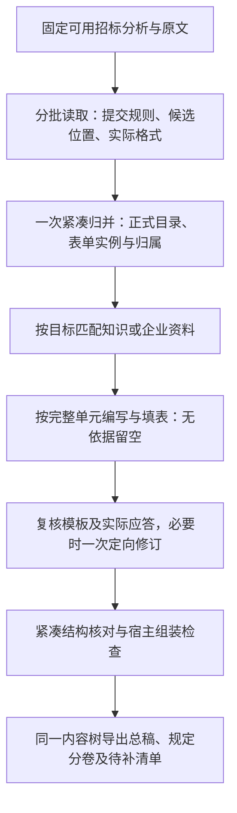

# 投标提交结构与表单归属修复方案

本方案对应BUG-040、BUG-054，兼顾BUG-053的引用追溯。用户已批准按此方案实施，
先完成隔离回归，再以同一原件新执行验证；不修改环境变量或覆盖已有产物。实际进度只在
[交接](handoff.md)维护，字段唯一依据为
[提交结构与模板实例](field-dictionary.md#提交结构与模板实例bug-054)。

## 目标与边界

根据本项目实际要求形成一套正式交付结构，将正文、规定表单及证明放入正确位置，
从同一结构导出总稿和分卷。保留所有适用必交表单，消除误插的说明/评审表和同实例
重复输出；资料不足照常留空导出，不能用空卷或局部候选冒充已整理的正式分卷。

原分析五节点不改。编制仍是现有组织、依据准备、写作、复核、组装的内部操作，
不新增Agent、主节点、审批门禁、通用模板库或多层路由。

通用性是实施约束：正式目录、分卷数量、填写主体及条件均从当前招标原文判断，
不预设商务/技术/报价三卷，也不固定附件号、表名、页码、来源ID或主体清单。
模型负责适用性、同一实例及提交归属的语义判断；宿主只处理引用、身份、预算、
恢复和展示。真实样例的定向原文选择只作为仓库外验收输入，不能进入生产分支。
信息不足保留条件、空位和待核，继续导出；单份真实文件通过不等于多类招标语义验收。

## 已确认的问题

| 问题 | 根因 | 本轮处理 |
| --- | --- | --- |
| 附件格式分组成为大量顶级章 | 局部候选与正式结构混用，归并未完成后直接拼接 | 局部结果仅作候选；正式目录统一组织，失败交待整理草稿 |
| 投标函位置插入形式评审表 | source_refs同时表示理解依据和交付模板 | 分开依据与明确采用的模板片段；只有后者允许渲染 |
| 相同原表重复，多个声明互相串入 | 缺填写实例语义；引用恢复到整个unit | 一个form目标是一份实际填写实例，有序选择精确模板片段 |
| 后批真实表单未进入对应分卷 | 归并丢父路径，提交组成约束未入请求 | 提交规则、候选父路径和格式角色参与归并；统一树决定组卷 |
| 最终内容引用未涵盖关联依据 | 关联规则提供了事实，但未全部进入可选支持表 | 装载相关原文并提供可选短引用，模型选择，宿主绑定正式依据 |

“附件”字样不决定对错。原文明示的编号、格式名称及顺序须保留；源文目录、格式标签、
成稿业务章节及真实证明附件分别理解，不能靠标题正则或文件哈希作语义合并。

## 完整业务顺序

图中是依赖顺序，不是新增工作流状态。无企业资料不会阻止B/C；只有本目标允许的
依据可写入相应应答。知识检索可以准备，但正式写作任务须绑定本次正式结构。

本轮正式结构由完整文档入口的`_organize`产生，即使来源只有一批也执行A。旧独立
`organize_outline/execute_outline`保留为单次来源候选预览：虽沿用AuthoringOutline
容器及路径ID，结果不代表正式目录，不能直接用于写作或分卷；当前没有生产导出
消费者，完整文档入口也不复用该预览。其调用仍为一次来源请求、最多四次发送，
不额外扩展其执行生命周期。

### 1. 从真实来源理解提交要求

既有原文读取同时识别：本次文件组成、目录顺序、独立分卷、适用对象/标段、提交
阶段，以及实际要求填写的格式。须知、技术规范、格式和补遗一起考虑；评审表可以
说明检查什么，不因此变成投标人必须提交的表。

原文明示目录和顺序优先；未规定的部分才合理组织。冲突、范围不明或来源不可读
保留具体待核，不由宿主用关键词裁决。提交组成不仅来自target.rule_refs，也须
在归并前装载constraint_rule_refs及相关实际原文，不等归并完成才收集。

### 2. 局部读取只提供候选

各来源批次提出有依据的业务位置、实际格式片段、适用范围和检索意图，不分别发布
一套正式目录。来源中的“附件1”可以帮助识别格式；是否成为某层级标题由项目最终
提交结构决定。局部“模板未定位”等意见先作为观察保留，不能在后批已找到格式后
继续对最终实例报告同一缺失；原观察和回执仍保留。

来源请求中的原文、网格及段落锚点只发送一份。模型选择宿主提供的锚点，宿主恢复
冻结selector与定位；模型不计算字符偏移、不重写原表、不回抄覆盖名单。

### 3. 统一正式目录和表单实例

归并输入包含实际提交约束、候选完整用途及范围、父路径、模板描述和必要原文，
不再把全部事项全文和全部抽取关系重复送入。完整要求仍在后续写作/复核按目标装载。
不能只给标题或ID要求模型猜分卷；对归属必需的条件、例外和原规定顺序不得压掉。

模型判断：是否本次适用交付、哪些候选是同一填写实例、实例放在哪个业务章节、
最终采用哪些有序模板片段。宿主生成正式身份，回绑来源和依据；不无条件合并所有
模板引用，不用同源去重替代适用性判断。

各source包的p1等短编号不能拼接。宿主从已绑定TemplatePartRef重建归并共享表，
重新分配pN及本次来源别名，为每个候选提供重映射后的template_part_ids；相同短编号
不代表相同原格式，也不要求模型誊写映射。

一个业务章节可以同时包含说明正文、规定表单和真实证明，各自保持对应关系。
沿用现有kind、target_id、chapter_id、children和is_volume，不增加instance_id、
owner_id或第二套分卷台账。实际填写实例由最终form目标表达：

- 同一投标函在须知、评分、格式页多次被发现，汇入一份实例。
- 投标人与制造商各需一份财务表时，建立两份实例。
- 不同标段、人员或对象按要求分别填写时，分别建立实例。
- 多页构成一张表时，有序片段组成同一实例；同unit内两份声明分别选取，不能整段重复。

对本次样例，依原文组成组织商务、技术、报价部分；技术部分遵循其明确要求的结构。
商务安置适用的投标函、身份/授权、声明、偏差、保证和资格资料；报价安置实际开标表
和规定价格表。这是此文件的推导结果，不能固定为所有招标项目的通用目录。

### 4. 依据与模板分开装载

source_refs提供理解、说明和支持；template_refs只表示明确采用的规定格式片段。
模型侧选短片段ID，持久侧由宿主保存原生来源及精确selector。一个模板片段可以是
完整原生网格或原文字片段，多个片段按确定顺序渲染。

无法区分同unit内多个表单边界时，保留位置和原件引用待核，不能把整个unit输出多次。
图像/扫描格式无法精确编辑时沿用真实可读原页及待补出口，不声称无损可编辑；本轮
不新增OCR、视觉模型轮或通用排版引擎。
原页/整图仅在已明确选作本实例完整模板时插入；页内多表、相邻内容或上下文无法
分离时保留原件引用和待补，不能用整页回退代替边界定位。

### 5. 按实际实例填写

有匹配知识或明确企业资料才生成企业功能、方法、人员、业绩及授权承诺；没有资料
相应位置留空。招标来源仍可支持背景、项目事实、明确的来源要求及固定格式。
关联规则实际提供且用于理解的原文，也须进入可选择支持范围，不能只留下无法选择
的关联引文；模型选择真实依据，宿主不把所有关联证据自动挂到所有内容块。

本轮一个form目标对应一份实际原表，不将人工价格和非价格部分拆成两份同表目标。
未建立精确字段策略的含最终报价表单整体manual_fill=true，保留原固定数量/条件与
填写空位，企业非价格字段也可以最后人工补；其他正文正常生成。本轮不新增manual_cells。
原格式如含示例/历史价格，必须区分示例与正式填值，报告人工清理位置；不能仅凭
manual_fill就宣称这些现成数字已经被清空，也不能将预算、数量或业绩金额一并抹掉。

网格固定文字由宿主渲染，模型只返回允许的格填值及有依据说明。文字声明先保留精确
原格式和空位，不再同时输出一份完整重写声明；本轮不建设任意文本表单替换引擎。
原规定第一人称声明仍是待填/待签格式，不能将固定措辞当作真实企业事实已核实。

### 6. 复核实际采用内容和结构

正文复核看到本任务的实际模板片段、填值、生成内容、证明及相应要求，避免只审blocks
而漏掉导出器实际会插入的东西。模板与支持文字按请求共享一次；无资料、全人工的
纯空位继续不做逐任务正文复核，有候选却被完整判空的语义结果仍沿既有纠正出口。

在现有复核能力中增加一次紧凑结构核对，读取真实提交规则、最终章节/分卷成员、
实例用途和必要模板上下文，检查误插、重复实例、错误归属及空卷。该核对只判断结构，
不凭目录摘要宣布正文充分；不把每个空表都送一轮完整正文审阅。意见沿现有findings
定位相关任务，全局意见可不指定任务，不要求模型誊写所有实例或覆盖名单。

结构意见和正文语义意见分别记录。结构核对失败/超限仍给出未完成核对的草稿，
不增加自动反复重排循环；需要改结构时带真实反馈新建修订，复用未变来源。
结构核对的实际操作、Prompt和payload同样固定到执行spec及请求摘要，不能让语义
操作变化命中旧回包。逻辑调用计划、失败尝试上界和实际付费发送数分别报告。

### 7. 同一树组装总稿和分卷

总稿和规定分卷从同一最终内容树及采用单元投影，不能各自决定表单归属。总稿中的
报价表与报价分卷中的报价表是同一实例的两种导出视图，内容版本和顺序一致。
同一实例内精确重复片段由宿主整理；不同实例可以合法使用同一模板。

宿主核对实际导出成员、树归属、模板渲染记录、填值和附件是否一致。只作为背景的
source_refs不渲染；form缺template_refs只留待补，不回退到输出所有来源。
来源SHA和正文不进入队列或被模型重新生成，仍沿CAS保存与现有请求摘要恢复。

## 容量和费用的五项约束

1. 调用数：`L=S+A+B+W+Rb+C+R2+F`。S是原文候选读取批次；A为一次紧凑归并，
   有可读候选时为1；B是知识共同依据批次；W是允许支持的实际写作；Rb是正文复核，
   C是已有的一次定向改稿，R2是改稿再核；F为一次紧凑结构核对，0或1。
   当前不可分单元不再拆正文复核的策略下，Rb/C/R2均不超过W，故
   `L≤S+A+B+4W+F`。首次加三次失败重试最多`4L`发送；检索Q按去重query及范围
   计，最多`4Q`次HTTP，供应商Embedding/重排费用另计。无知识时B=0，企业空位
   不增加W/Rb；F可能仍为1，这是结构核对，不与BUG-052的逐空位正文复核混淆。
   不做事项、章节或表单两两组合；S及候选规模随实际原文增长，不能承诺所有规模
   的目录都能一次归并，更不能把超过窗口的候选隐藏在免费宿主摘要里。
2. 单请求同时计完整Prompt、必要语义、输入及输出。S输出含候选/格式片段/检索意图；
   A输入含全局提交规则、完整候选用途/范围、父路径和必要格式上下文，输出为目录、
   目标合并及模板选择；F输出仅具体问题，不重写目录和全文。W/Rb/C/R2按完整业务
   单元装载相关要求、去重支持和原格式。输出预留须按实际工作量校准，不是API硬限。
   超限不截掉条件，不让模型自己切Unicode字符，不使用未经当前模型校准的Tokenizer。
3. 问题出口：缺资料留空，缺模板/边界不清保留位置，语义争议留待核，局部模型失败
   沿现有三次重试后占位。A未完成时，不把分包标题直接当正式章；保留已整理结构
   和明确“待整理内容”，无可信结构时输出待整理总稿。可以输出已经完整组织的分卷，
   不能以商务/技术/报价正式卷名输出仅有早批片段的空壳。文件和已有内容可下载，
   是否业务合格另报；存储或导出技术失败按真实恢复状态处理。
4. 修订代价：只改样式/编号投影重导出，新增模型调用0。改模板选择或归属至少重做
   受影响的组织及结构核对，内容改变时重写并复核相关单元；共同安排变化扩大依赖。
   本轮新增模板语义与边界字段会改变来源Prompt，旧17回包不能免费升级，首轮须
   重跑受影响S并重新准入。旧分析和原始CAS可以复用；章节/目标重编号可能使正文
   请求广泛变化，不能承诺仅加一次归并就复用全部旧稿。不清缓存、不加摘要盐。
5. 模型只作语义选择和有依据的新内容：选择tN/pN/sN等短引用。宿主派生正式身份、
   selector、元数据、依赖、卷成员和渲染顺序，不让模型抄CAS、位置偏移或已知覆盖名单。

本轮旧回包的纯容量投影：移除全量共享规则及冗余规则引用、保留候选完整用途等，
从145,661降至68,498；加入真实规定目录全文后为69,143，低于94,208字节估算准入。
这不是新版完整payload通过：模板角色、片段描述和全部实际提交条件尚待新合同产出。
当前没有预建多层router的必要；先让同一106页完整新版请求在已有一次归并中实测，
确实超限则保留草稿与容量缺口，不能悄悄恢复旧拼接。运行证据和动态结果只在交接维护。

## 实施任务与验证

| 顺序 | 精准修改 | 成功标准 |
| --- | --- | --- |
| 1 字段与样例 | 统一候选/正式结构边界、template_refs精确选择、整表人工策略；同步schema及往返样例 | 历史结果可读但不会自动将source_refs当模板，新合同缺模板留空不拒绝整份生成 |
| 2 来源与归并 | 原文已有读取内识别格式角色/边界；归并前装载提交约束、保留父路径，压缩重复规则；模型明确选择最终模板片段 | 评审表只作依据；同实例候选汇总；不同对象实例保留；完整输入与输出重新准入 |
| 3 写作与复核 | 模板按实例装载、限定填值；关联原文进入可引用支持，复核看到实际采用内容；增加紧凑结构核对 | 原表与重写声明不双出；未知企业信息/价格留空；依据完整可追溯；核对成本单列 |
| 4 组装与恢复 | 仅渲染明确模板，从一棵树导出全部视图，保留来源/旧稿与真实缺口 | 总稿与分卷实例一致，归并失败仍可下载明确草稿，同ID恢复不新增付费 |
| 5 真实验收 | 同一106页先测无知识场景，再独立验真实知识资料匹配 | 实际商务/技术/报价组成及必交格式归位；原表/空位/分卷实物检查，计量全部调用和耗时 |

先补有区分力的失败用例，再改最小实现；不为标题单独加词表或禁用“附件”。
必要反例包含：上下文评审表不输出、同实例多处发现只输出一次、多主体同表分别
填写、同unit多声明不串入、多页表有序合成、无模板不整unit回退、混合报价整表人工、
早批占位和后批真实格式合并、补遗替换版本不盲目并集、归并/复核失败仍导出草稿。

真实验收须实际打开总稿及各分卷：商务包含适用函件/资格表，技术遵循规定顺序且有
对应响应位置，报价包含真实开标/价格表；空资料保留规定格式及空位，未知企业事实
和最终价格没有自动补入。对来源允许、表单实例、适用范围、固定内容和证明一起审，
不能因目录引用齐全就判合格。

验收分别报告：文件完整性、引用合同、业务结构、内容语义。没有知识库时只验证
无知识留空和结构，不宣称知识召回已合格；生成成功也不意味着已签章或可以直接投标。
逐项勾选以[15项提交结构验收](acceptance.md#提交结构与表单归属验收bug-054)
为准，不能将本方案已写完记为代码或真实验收完成。

## 剩余问题的最小修复与验收

### 统一剩余修复（BUG-060/065—068）

先更新唯一字段字典，再在既有A增加未安排规则选择、明确的跨目标引用、封面角色和
原表表头展示信息。仍由模型判断语义，宿主处理身份、定位、版本、原件、覆盖及导出。
证明目标按实际文档版本API取原件；检索命中和原件存在都不能替代适用性判断。未知
企业应答和最终价格留空，不新增生成门禁。目录、封面、重复表头和可读提交待办在
导出器完成，不建设通用排版引擎。

1. 全文件模型调用仍为`L=S+A+B+W+Rb+C+R2+F`，不新增语义阶段或逐条归属调用；
   未安排规则一次进入A，随规则文字线性增长。模型请求首次加三次，发送最多`4L`。
   真实语义评测N例为N逻辑请求、最多4N发送，与真实文件运行分开统计。检索Q个
   去重query，只有需要证明原件的命中进入D个元数据和K个对象请求，总HTTP上界
   `4(Q+D+K)`，D最多每query的8个命中，K≤D；同执行恢复沿冻结回执复用。
2. 每个完整A请求包含候选、原表、必要提交原文和未安排规则，必须重新离线计量，
   不假定原8.56万输入仍适用。131072上下文当前预留32768输出及4096安全余量，
   输入上限94208；输出随实际章节/实例/补充归属增长，预留不是供应商硬限。原件
   下载有文件大小上限且按实际内容SHA去重，不把完整文件二进制发文本模型。
   A复用已有project_source_sections投影，完整模板标题路径在template_sections
   发送一次，部件仅带section_id；不改变原生网格、模板定位及规则语义。来源S请求
   不变，仍只重跑A和实际请求改变的下游，不新增摘要调用或模型身份回抄。
3. 未安排规则或跨目标引用语义不明保留诊断及底稿；原件认证/版本/哈希/下载失败
   留片段与待补；表头不明不猜；单元超限或重试耗尽保留草稿。模型判断、知识服务、
   导出器和业务人员各处理自身范围，不能只有阻断没有出口。人类GT须由人完成。
4. 旧成功执行不覆盖。S Prompt不变时复用相同来源回执；A或其输入变化重跑一次A及
   实际摘要改变的下游。纯展示修复可零模型重导出；检索原件合同升级使用新快照，
   变化query重查，最终请求完全一致才复用。评测改一例只使该例失效，改Prompt/模型
   则全部N例失效。分析提速须独立新运行，不拿编制1分54秒替代五节点耗时。
5. 模型只选择未安排语义、引用关系、封面及可判断表头，并写有依据的应答；不誊写
   原文全集、CAS、永久身份、宿主目录页码或执行覆盖。检索query的原件需要由宿主
   从既有目标用途派生，原件定位/验证及正式章号由代码完成。

验收顺序：隔离反例与回归→同文件无资料结构复测→真实资料技术/评分/偏差纵切→
完整非空正文和证明→更新字段后的DOCX/PDF实物→独立分析/语义评测。没有真实
资料或人工标注时先完成代码与可复现证据，明确尚缺的输入，不制造资料或宣称验收。

### 真实复测发现的目录与核对衔接（BUG-069/070）

来源S用既有constraint_range_ids把结构条款及其引用的真实目录/组成一并交给A；
推导heading_path只作定位。A/F均核对受约束的父子层级，不把同级降为子级解释成
顺序未变，也不因分组本身没有填写字段就省略规定组成。F只补读未安排/明确排除
规则的实际语义、引文和理由，已安排全集不重复发，不增加自动重排循环。

1. 公式仍为`S+A+B+W+Rb+C+R2+F`，首次加三次重试最多`4L`，没有新增模型轮。
2. S新增提示及选择的目录计入实际请求，F新增处置按未安排/排除语义大小线性增长；
   每次仍留32768输出和4096安全量，完整输入须≤94208，不截原文或提高上下文过关。
3. 目录确实不可见、结构歧义或核对超限沿已有待核草稿出口，文件与完整底稿保留；
   模型判断语义、宿主交接引用，需外部资料的事项继续留空，不新设门禁。
4. S Prompt改变须重跑实际S批次及请求改变的A/下游；不能只补私有样例目录、继承旧S
   后宣称通用修复。仅F投影变化时来源和未变写作可复用，旧成功执行不覆盖。
5. 模型只选择实际目录引用并作语义安排/核对，不誊写元数据、全部处置名单或宿主身份。

BUG-071沿相同边界补充A语义：规定响应位置应有target/空位或已确认的跨位置参见，
不能主题合并后只留空标题，也不因无独立原表造格式。没有新增调用轮、字段或门禁；
只变A提示时S可按原摘要复用，输入和输出仍按完整A/实际位置数量计量，失败出口不变。
BUG-072同步澄清A/F：实际文件分组沿is_volume表达并由宿主导出，人工平台动作另留
待办。原文明示分别提交文件才分组，不能只按业务章名/部分数量分卷。仍只重跑A/F
及实际变化的下游，S请求不变则复用；没有新增字段、调用轮或门禁。

### 数据保留优先修复（BUG-063）

已知要求与企业应答分开：沿字段字典新增只读要求底稿，完整保留当前规则及目标
绑定；写作/改稿/复核只处理企业应答。正文位置显示已有要求及空白响应，原规定
form不盲目重写或追加假定等价表。全部规则随包交付，未安排或被排除候选关联的规则
也不从底稿删除，不据此判断本次适用性。只有来源没有规则时仍保留引用及待核，
不能自动把所有背景、评审表插入正文。

1. 调用：沿既有`S+A+B+W+Rb+C+R2+F`，本次宿主快照及展示新增模型调用0；遍历成本
   按规则数和目标引用数线性增长，不逐规则调用模型。
2. 请求最坏输入/输出：模型请求与响应合同均不变，底稿不重复发送；新增本地JSON及
   DOCX展示大小按规则文字、引文和关联数增长，长条件不截断以追求短文件。
3. 出口：已知规则不可读时保留完整引用并提示；来源不可读保留已有规则/引文；无规则
   不猜事实。写作失败、无知识、整块应答被否定或改稿失败均保留底稿及文件，不新增门禁。
4. 修订：从当前冻结分析和最终关系重建新底稿；以新execution继承完整请求相同的回包，
   新增付费0。旧成功execution仍返回原结果，不覆盖旧DOCX或把旧状态改成新验收。
5. 模型只作既有语义组织和企业内容判断；不新增要求回抄、ID誊写或逐行覆盖回执。

先以无知识、写作失败、unsupported_content剔除、改稿失败、补遗删除、未安排规则、
原表人工报价及source-only背景反例验证数据保留，再重放同一真实文件。数据底稿完整
与正式参数响应表的语义/版式完整分别验收，不以JSON存在代替最终Word逐项可见。

### 正式标题与可读展示修复（BUG-062/064）

沿现有一次assembly明确title语义：来源附件号、表号、原章号只是源内标识，不因
候选title_path带编号就继承为正式章节名。依本次投标目录及业务关系组织正文、表单
和证明，不从一份原表自动推导一个子章，也不禁止有实际需要的独立表单章节。
原文明示投标目录名称时仍遵循，原格式内部标识保留；模板选择须区分外层格式分组
和实际表内标题，不能为减少重复而截断表体、跨页续段、备注或签署栏。

执行优先级：实际投标文件的规定组成、层级及相对顺序，高于业务归并和标题简化。
先由模型依据提交条款判断哪些结构受约束，保留这些关系，再调整允许自拟的名称；
没有结构约束的部分才可自由归并。主题覆盖不能代替规定结构，原表编号也不因此
重新进入章节标题。此修订仍在一次assembly内完成，以下五项调用/容量边界不变；
只重跑A及请求实际改变的下游，沿既有结构待核出口保存草稿，不增加全文件重读。
最少部件选择仅省略纯编号/分组标签和确实无关的部件，不省略所属表单的填写字段、
适用条件、证明材料或备注；标签与实质说明同段时保留整段，不为了标题简化丢信息。

Word按已有协议字段显示要求细则，内部完整字典仍在底稿；不倾倒JSON、不删除有值
细则、不用标题/标点正则猜业务语义。来源读取Prompt不变，标题在assembly中重新
组织；旧assembly不能因schema未变就免费补认成满足新标题语义。

1. 调用公式仍为`S+A+B+W+Rb+C+R2+F`，不增加主节点或逐表标题调用。来源请求保持
   完整一致时S可复用；A需要一次新调用，实际改变的写作/复核按摘要重算，不能承诺
   整轮零费用。仅展示修订新增调用0。
2. A仍发送共享候选、必要提交原文和完整已选模板一次，新增提示计入实际准入；其
   输出随真实章节/实例数增长，不能为压缩标题丢目标。下游请求沿既有完整单元预算，
   输出预留不是API硬上限，实际输入/输出及尝试次数在真实验收中记录。
3. 标题组织或模板选择失败走既有有限纠正及待整理草稿出口；任何失败均保留要求
   底稿和旧回执，不因未得合格标题禁止导出。未知旧字段可读展示并待核，不JSON兜底。
4. 新execution继承未变来源回包，重新执行A及实际变化的下游；旧成功结果、原文和
   底稿不覆写。展示层不改变要求语义，原底稿可复用；新目标关系需要重建底稿映射。
5. 模型只生成业务标题、组织关系及明确模板选择；宿主继续生成章节号、正式身份和
   定位引用，不要求模型回抄原表、CAS或覆盖清单。

离线验证宿主能保留模型给出的业务章节并正确回绑原表；真实验收必须打开最终目录
及正文，逐项核对来源标签没有机械进入正式title、原表标识/表体/备注完整、细则可读。
测试替身或检查Prompt文字不能证明模型实际完成该语义整理。

本节承接真实草稿审阅，规定下一批修改范围，不表示以下工作已实施或通过验收。
实际执行、回归与部署状态只在[交接](handoff.md)维护。优先完成有依据的提交结构，
再验证真实知识匹配与长篇正文，最后检查交付版式；各阶段均可保存、预览和下载草稿。

### 1. 先确认六条意见，再修正确认的问题

F的意见是待核线索，不是全部成立的漏项。先对照冻结原文、真实模板及最终章节树，
逐条记录原要求、适用条件、现有位置和处理依据。该核实复用本地原文与回执，不发
一轮全文件模型审阅；确需模型理解的局部来源进入下述一次补读。

| 审阅事项 | 处理原则 | 完成依据 |
| --- | --- | --- |
| 8D投标人与原厂财务表 | 按实际要求区分填写角色；原文明示分别提供时，以现有form目标表达各自实例，purpose保留条件。主体关系未提供时明确待核，不默认两者不同，也不只用一个“分别填写”目标代替两份适用实例 | 不同主体时各有独立填写位置；主体相同的适用方式有来源或人工依据，同模板可合法复用 |
| 附件3货物规格一览表 | 核对真实原表及其他表是否确能覆盖，确认未覆盖才补位置；要求明确但格式未取得时保留有来源的空位 | 实际模板及归属明确，或记录具体待补；不按目录名称凭空造表 |
| 附件9报价承诺函 | 查明是否独立格式、是否已包含在其他函件及平台报价模块，不据目录标题自动复制一份 | 独立要求有对应位置，或有依据说明已经包含；未确认继续待核 |
| 技术部分顺序 | 对照第二卷实际目录、格式和适用内容，优先按原规定顺序组织，未规定部分才自拟 | 原规定内容可对应到实际技术章节及响应位置；不可读来源如实记录 |
| 可编辑版本压缩上传 | 明确所需文件、命名、压缩和上传位置，作为提交说明/待办；生成ZIP不代表平台上传已完成 | 导出文件与上传要求可核对，外部操作保持待办，不强迫成为正文一级章 |
| G.2偏差表 | 无产品/应答依据时继续留空；匹配资料后逐条判断支持程度及实际偏离 | 空白不解释为“无偏差”，确认后的结论有相应要求和资料支持 |

备件推荐报价清单的模板缺口一起回查：按原要求保留人工填写位置，找不到格式时
明确记录，不宣称已经取得模板。最终价格继续人工填写。

### 2. 优先完善现有一次归并，不建设通用结构改稿器

修复入口仍是现有来源读取和A归并。A已经允许一个候选在确需不同填写实例时被多次
选择，现有target、purpose、template_refs及章节树足以表达本轮业务，不增加owner_id、
instance_id、volume_id、主体确认门禁或第二套事实台账。

具体修改顺序：

1. 核对A实际收到的提交规则、规定顺序、候选用途及模板，而不是只核对数据库是否存有
   原文。缺失的提交依据由宿主按冻结引用装载，条件、例外和来源身份完整保留。
2. A现有模板表只包含来源候选已选中的片段。若实际要求/模板尚未成为候选，则仅对
   已定位的相关原文做一次补读，复用现有outline来源操作及OutlineResponse合同，
   宿主回绑后加入候选；已接受且请求未变的原来源结果继续复用。补读范围先固定，
   不从F递归追索新范围；补读分包同样按完整容量计费，不能当作免费宿主推导。
3. 补充A的语义用例：分别填写的主体、条件性附件、规定目录顺序，以及“已有要求但
   暂无模板”的待补位置。模型判断用途和适用关系，代码只组织引用、身份及渲染。
4. 新执行采用修正后的A结果，按真实依赖写作/复核，末尾F仍只核对一次。保留旧稿、
   旧意见和核实证据；新F重新判断，尚未解决的事项继续随草稿交付。

现有AuthoringReviewRequest只把target_ids及reason送入正文复核/修订，不进入A。
本批不扩展为结构修订接口，也不把F的意见直接当成重排命令；归并修正依据是已核实
原文、候选和明确的业务用例。若这些仍不能解决具体问题，再凭真实反例讨论一次有界
结构修订，不能预先加入自动反复重排、反复全读或多级Agent。

实施核实发现两个必须补齐的通用衔接（BUG-057/058）：A的原表投影丢失非首行及真实
路径；来源适用性finding未送入A，且不选候选又会被宿主强制追加。先按字典补齐完整
共享网格/路径、只读来源观察和可选excluded_targets处置，模型依据原文判断排除、宿主
核对引用并保留理由。生产逻辑不含当前文件的附件编号、名称、页码或范围ID。

已定位的相关原文可通过可选submission_sources只读补充进A/F，仍绑定本次冻结快照，
不改变四份来源请求及其已接受回包；已有候选只缺判断依据时无需再做来源调用。确需
新增候选或模板选择时才进入一轮局部补读。来源不可读、条件冲突或未处置候选继续留
待核/待整理，缺口不阻断导出。模板Markdown展示问题沿渲染器单独处理，解释格式语法
不参与业务语义判断，也不改原文和selector。

### 3. 用真实资料验证要求、评分和应答之间的对应

结构核实可以在无知识库场景完成；实质应答质量另用可用的真实知识资料验证。先取
同一招标文件中一组技术要求、一个实际评分点、一个偏差表位置，以及相关实施/售后
要求，使用已有检索、写作及复核能力走通纵切。库中无适用内容的部分继续留空，不用
模型常识填充，不为了得到非空正文而临时编造企业资料。

逐条核对链路：`招标要求/评分依据 → 检索资料 → 适用依据 → 章节/表单应答 → 最终引用`。
检索命中只代表候选；模型仍判断功能、版本、主体及适用范围。只匹配功能也可生成
有依据的应答，型号/配置可选；未提供的人员、资质、业绩、工期承诺和最终价格不补造。
评分点应对应具体内容或明确缺口，不承诺实际得分。实施、人员、服务、售后等只按本
项目要求组织，不把通用章节清单硬套给所有项目。

纵切验证后扩展到同文件完整编制：按章节/完整表单分批生成，资料支持按请求共享，
全文通过同一内容树组装。核对跨章节的功能、供货、实施、服务、人员和证明是否一致，
分别报告本次真实检查范围；现有局部复核不能自动证明全篇一致。没有真实知识资料时
先交付结构及留空结果，将真实知识匹配明确保留为待验收，不以模拟命中替代。

### 4. 最后验收实际文件

检查总稿、各卷及附件包的成员、顺序和内容；再实际查看字体、页眉页脚、表格分页、
目录及页码。发现的版式问题沿原渲染/导出器最小修复，不先建设通用排版引擎。签章、
人工报价和平台上传按真实完成状态记录；有缺口仍交付草稿及清单。

### 本批调用、容量和恢复约束

1. 沿用`L=S+A+B+W+Rb+C+R2+F`，S包含正常来源批次及本批一次补读轮的实际批次，
   不新增模型阶段。A最多一次、F最多一次；`Rb/C/R2≤W`，首次加三次失败重试的发送
   上界仍为`4L`。原文读取随实际来源量增长，写作/复核随有允许支持的业务单元增长，
   不做事项或章节两两组合。知识查询按query及范围去重，HTTP最多`4Q`，无命中不
   因空结果反复检索；Embedding/重排费用与未知用量单列。
2. 本次结构修订新增逻辑调用按实际失效请求计：
   `ΔL=S增量+1A+B增量+W增量+Rb增量+C增量+R2增量+1F`。
   仅修正A且原来源请求未变时，原来源可复用；新补读、材料变化及下游摘要变化计入
   增量。章节重编号可能扩大写作/复核失效范围，先离线比较真实请求摘要，不承诺只
   付A/F两次，也不先为此引入稳定身份系统。完整最终请求不变才复用成功回执。
3. 每个请求完整计Prompt、原文/候选、必要规则、去重支持及输出。当前同模型、同
   目的地校准下，131,072窗口保留32,768输出和4,096安全余量，完整输入上限94,208；
   framing计入估算。32,768是输出预留，不是API输出硬限；来源输出随候选/模板数、
   A输出随章节/实例数、写作输出随实际业务单元增长，均须先估计最坏输出。不可分
   表单或A超限时保留待整理出口，不截断条件或宣称已经处理。更换模型/目的地后重新
   校准，不固定承诺所有文件均为4个来源包。
4. 新增风险与出口：候选仍不全时由一次局部补读补齐、仍不可得则留空；主体/适用范围
   不明由模型保留条件、业务人员补确认；模板重复由模型区分实例、宿主只去除同实例
   精确重复；检索不到由知识服务返回具体缺口、写作留空；局部模型失败沿同一重试额
   度后保留草稿，存储/取消/失租按已有恢复处理。F未解决意见不新增导出门禁。
5. 模型只选择当前短引用、判断业务关系及编写有依据的内容；正式身份、模板定位、
   元数据、依赖、卷成员和覆盖由宿主管理，不要求回抄原文全集、CAS或已知覆盖名单。

### 执行任务与验证顺序

| 顺序 | 交付 | 验证 |
| --- | --- | --- |
| P1 原文核实与字段复用 | 六条意见及模板缺口逐条有依据；现有字段足够则只修改A上下文/用例，必要时一次来源补读 | 明确哪些是确定不足、条件性要求、资料待补；先补多主体/漏候选/规定顺序的区分性反例 |
| P2 结构修复与同文件验证 | 复用不变回执的新执行；实际目录、表单实例与三卷归属对应原要求 | 检查DOCX和三卷实物；F意见逐条重核，报告调用、用量、耗时、复用和未解决事项 |
| P3 真实知识纵切与全文件 | 先技术/评分/偏差小样，再完整分章应答，未知信息及最终价格留空 | 对照招标原文、真实资料、生成内容及最终引用，不以命中数或非空率代替质量 |
| P4 文件交付与视觉核对 | 同树总稿/分卷/附件包及具体待补清单，按实际问题修版式 | 文件成员一致、表格可读、分页和目录可用；草稿、内容充分与外部提交分别报告 |

本轮先完成方案，不将待实施任务勾选为已完成；源码修改前仍按唯一字段字典核对，
如确需改字段先更新字典及往返样例，再改schema、请求、恢复和测试。

### 技术要求入表复查（BUG-063/071）

已确认部分参数在不同章节重复，规定主要参数位置却只有后果要求；证明和原表目标
上的要求还被导出器过滤。先修确定的宿主丢失：每章汇总全部目标已有规则，按完整
身份去重展示一份要求底表，保留原表实例及企业空应答。零模型调用，输入/输出模型
预算不变；重导出不重跑分析/写作，不改变旧成功执行。新风险是要求底表增大，以同章
去重控制机械重复，跨章用途由模型决定；规则不可读保留位置和具体缺口，不阻断导出。
不用模型重抄规则、覆盖清单或原文。实物验收按唯一要求及原文条件核对，不用表格行数
证明召回，也不把模型自由文本purpose当作其rule_refs实际覆盖的证据。

关联修复须将实际“引用其他响应位置”的原文沿已有constraint_range_ids交给A/F，
由模型建立related_target_ids，宿主显示正式参见；不能靠标题规则挪动参数。来源阅读
继续S次、组装1A、末尾1F，不新增全文件语义轮；总调用仍为上式，输入增加所选引用
约束原文、输出增加实际关系短引用，完整输入和输出预留仍按预算准入。来源Prompt
修改会使S及依赖请求失效，应按真实摘要计新增调用，不能宣称零成本或强行复用旧S。
无法确定引用实例时保留原要求和待核，不以错误参见代替应答。仅补参见不能证明逐条
内容完整；还须核对已绑定的参数、证明、评分及偏差条件确实进入对应实际文件。

### 纯引用位置与规则适用范围（BUG-071继续修复）

真实回执进一步确认A借内容候选建立了来源阶段未生成的引用位置；旧合同不能表达
仅有related_target_ids的目标，实际选择target_ids后继承了其规则。最小修正是允许narrative纯参见
目标仅选择已有related_target_ids；模型结合已提供submission_sources决定位置，
宿主不继承引用对端的规则/模板/内容，也不将该对端自动判已安排。来源宿主验证
同步不再将实际来源/模板支持的位置报未绑定。无需修改S提示，不扩展通用规则搬移
协议。未知、未安排和多实例引用歧义仍走既有诊断及草稿出口，不静默选一个实例。

1. 调用仍为`L=S+A+B+W+Rb+C+R2+F`，不新增请求或事项两两检查；S随原文规模、
   W及其复核随实际业务单元增长，失败发送上界仍4L。
2. 单请求完整输入仍受准入约束，输出为候选/引用或相应业务单元，32,768仍是预留。
   现有真实A仅余4,808输入估算Token，增加共享已安排规则即使只传完整正文及范围
   条件也会新增18,246；不以去掉条件、提高窗口或静默截断解决。此修复只增加少量
   A提示并允许已有related字段单独表示纯参见，不增加语义台账输入；输出只增加
   实际引用位置的已有字段，真实A请求仍预审。
3. 空rule_refs不证明无要求或已覆盖；宿主继续保存未安排规则和未读来源诊断，模型
   不能识别引用目标时保留待核。目标确实无依据时仍记录缺口，继续交付草稿。
4. S提示及实际请求未变时复用四份已接受来源回包；A及实际失效下游重新执行，
   不重跑五分析节点。验证真实混绑是否消失，
   以及原位置的报价、后果规则和19条核心参数是否仍在，不以删规则换取干净标题。
5. 模型仅选短引用和说明业务用途，不重新抄写规则、宿主身份或全量覆盖清单。
